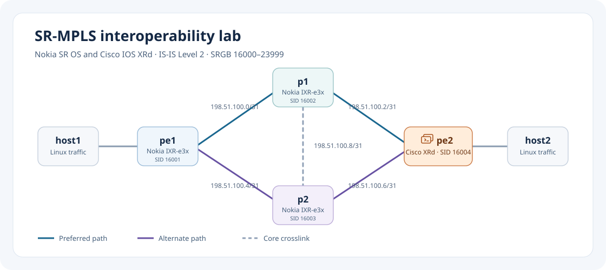

# SR-MPLS interoperability lab

Repeatable Containerlab scenarios for Nokia 7250 IXR-e3x (SR-SIM 26.10.R1) and Cisco IOS XRd 26.2.1. The documented results distinguish signaling, packet forwarding and measurements that require physical hardware.

[Open the interactive topology](https://coolexer.github.io/sr-mpls-interop-lab/) · [Test procedures and results](docs/tests.md) · [Selected lab evidence](docs/evidence.txt)



## Topologies

| Topology | Purpose |
| --- | --- |
| [Services and protection](diamond.clab.yml) | IS-IS SR-MPLS, PHP and explicit-null, EVPN-MPLS, VPNv4/v6, BGP PIC, TI-LFA and Flex-Algo. |
| [PCEP and telemetry](baseline.clab.yml) | Classic and colored PCEP, BGP-LS, BGP-LU, color steering, on-demand LSPs and ingress MPLS cflowd. |

## Deploy in Linux or WSL

Use Containerlab 0.83 or newer, Docker, a valid SR-SIM license and vendor images already available to your Docker host. Set the three values to your own image references and license path.

```sh
export SRSIM_IMAGE='nokia_srsim:26.10.R1'
export XRD_IMAGE='xrd-control-plane:26.2.1'
export SRSIM_LICENSE='/absolute/path/to/your-srsim-license.txt'
sudo --preserve-env=SRSIM_IMAGE,XRD_IMAGE,SRSIM_LICENSE containerlab deploy -t diamond.clab.yml
```

The Nokia nodes use the underlay startup configurations from `configs/`. Apply `configs/pe2-underlay.cli` to PE2 first, then apply the overlays in the [test runbook](docs/tests.md). Use the credentials and access methods supplied by your own Containerlab deployment.

If direct access to XRd management is unavailable, use the container's default network namespace over SSH. This example prompts for authentication if your environment needs it.

```sh
pid=$(docker inspect -f '{{.State.Pid}}' clab-sr-interop-pe2)
sudo nsenter --net="/proc/$pid/root/run/netns/vrf-default" -- ssh clab@127.0.0.1
```

For the PCEP topology, deploy `baseline.clab.yml` with the same three variables and apply `configs/pce.cli` on pce. The cflowd test also assigns an IP address to the host-side test link. The [runbook](docs/tests.md#pcep-and-telemetry) includes those steps.

## View and demonstrate

- Open either `*.clab.yml` in **Containerlab TopoViewer**. The companion JSON stores the layout, styles and action buttons. The layout uses the VS Code extension 0.27.0 annotation format. [Containerlab Apps](https://srl-labs.github.io/containerlab-app/docs/)
- Use **Run L3VPN probes** and **Capture PE links** on a running services lab. Capture writes a local pcapng. The public web preview is a read-only topology viewer. [Script buttons](https://srl-labs.github.io/containerlab-app/docs/guides/script-buttons/)
- The [Draw.io file](docs/diamond.drawio), [Mermaid source](docs/diamond.mermaid) and [SVG preview](docs/topology.svg) can be reused in documentation. [Containerlab export formats](https://srl-labs.github.io/containerlab-app/docs/guides/export/)

All lab configuration addresses and identifiers are for the example. Vendor images, licenses, credentials and raw lab logs are supplied locally.
